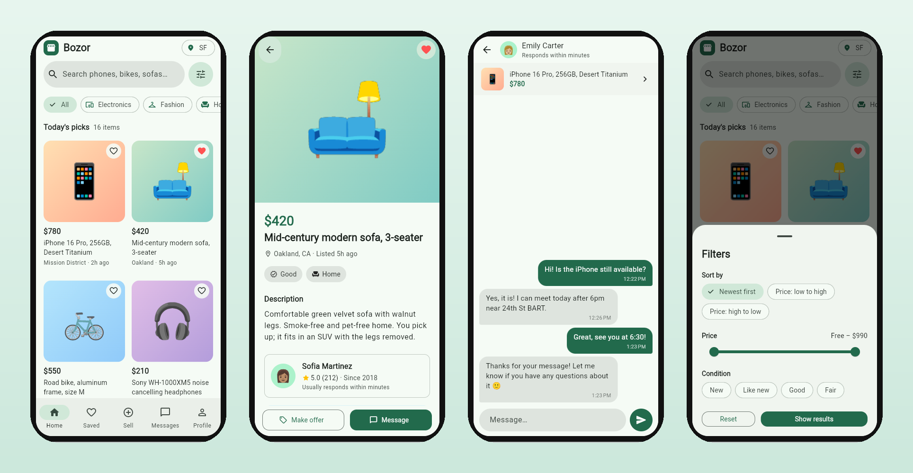

# Bozor: Buy & Sell Locally

**🔗 Live web demo: [kinglant.github.io/bozor](https://kinglant.github.io/bozor/)**

A C2C marketplace app (in the spirit of Facebook Marketplace, OfferUp and Mercari) built with **Flutter**. One codebase runs on **Android, iOS and the web**. Users browse and search listings, filter them, save favorites, chat with sellers and post their own items with photos.



## Features

- **Browse & search**: a responsive grid of listings with instant search across title, description and location.
- **Categories & filters**: category chips, a filter sheet with sorting, a price range slider and condition, and a badge that shows how many filters are active.
- **Listing details**: a photo carousel with a Hero transition, condition and category tags, a seller card with rating, a safety tip and "More from this seller".
- **Buyer–seller chat**: quick replies, "Make offer" with a suggested price, a typing indicator and unread badges. In the demo, sellers answer automatically.
- **Sell an item**: pick up to 5 photos from the gallery (`image_picker`), with form validation, a category dropdown and condition selection.
- **Saved items & profile**: favorites, your own listings with "Mark as sold" and "Delete", and stats.
- **Persistence**: favorites, your listings (photos included), chats and the theme are stored locally with `shared_preferences`.
- **Material 3 design**: light and dark themes (system, light or dark) and an adaptive layout from phone to desktop.

## Tech stack

| | |
|---|---|
| Framework | Flutter 3.50 · Dart 3.14 |
| UI | Material 3 (`material_ui`) |
| State management | `provider` (`ChangeNotifier`) |
| Storage | `shared_preferences` |
| Media | `image_picker` |
| Formatting | `intl` |
| Tests | `flutter_test`: unit tests for the store and a widget test for the main flow |

## Architecture

```
lib/
├── main.dart                    # App, themes, bottom navigation shell
├── models/models.dart           # Listing, Seller, Conversation, enums (+ JSON)
├── data/sample_data.dart        # Demo listings, sellers and chats
├── state/market_store.dart      # Single source of truth: filters, favorites, chats, persistence
├── widgets/
│   ├── listing_card.dart        # Card + responsive sliver grid
│   └── common.dart              # Listing image, empty states, formatters
└── screens/
    ├── home_screen.dart         # Search, categories, results grid
    ├── filter_sheet.dart        # Sort / price / condition bottom sheet
    ├── listing_detail_screen.dart
    ├── chat_screen.dart
    ├── messages_screen.dart
    ├── favorites_screen.dart
    ├── sell_screen.dart
    └── profile_screen.dart
```

All app state lives in `MarketStore`, so the UI only reads from it and calls its methods. The demo data comes from a local source. Moving to a real backend (Firebase or Supabase) means changing only the store's load and save methods, not the screens.

## Run it

```bash
flutter pub get
flutter run            # Android device / emulator
flutter run -d chrome  # Web
flutter test
```

Build a release APK with `flutter build apk --release`.

## Credits

Listing illustrations are rendered from [Noto Color Emoji](https://github.com/googlefonts/noto-emoji) (SIL Open Font License 1.1).

---

Personal portfolio project.
